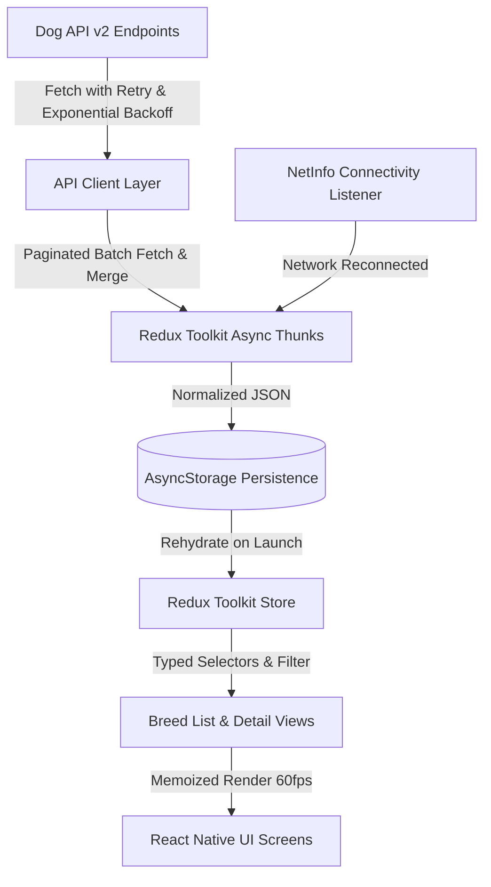

# Architecture & System Design

## Overview
Dog Explorer is an offline-first React Native mobile application engineered for responsive browsing of the Dog API (v2) 283-breed catalog. It is built around a unidirectional data flow architecture where local persistent storage acts as the single source of truth for UI renders, with Redux Toolkit managing normalized client-side state and async synchronization thunks.

## NOTE:- in the assignment 48/page is mention but 30 records are being fetched per request/page

## Layer Responsibilities

### 1. API Client Layer (`src/api/client.ts`)
- Implements exponential backoff retry logic (starting at 600ms).
- Handles paginated fetching across API pages (`?page[number]=N`), dynamically resolving the total page count from `meta.pagination.last` and merging all 283 records cleanly into a deduplicated collection.
- Enforces strict runtime type assertions using TypeScript type guards.

### 2. State & Persistence Layer (`src/store/` & `src/storage/`)
- Redux Toolkit (`configureStore`, `createSlice`, `createAsyncThunk`) manages normalized application state.
- Persistent cache backing via AsyncStorage.
- Instant app rehydration upon launch (<300ms) with zero layout shifts.
- Seamless sync on network recovery monitored by `@react-native-community/netinfo`.
- Tiered image cache index tracking access times and memory footprints under a 50MB disk budget.

### 3. Presentation Layer (`src/screens/` & `src/components/`)
- Pure, memoized functional components (`BreedCard`, `TraitScaleMeter`, `GalleryTab`, `OverviewTab`, `TraitsTab`).
- Virtualized list rendering via optimized `FlatList` with on-demand pagination (`onEndReached`) and memoized card layout.
- Multi-facet filtering engine supporting debounced keyword search, group selections, derived size bucketing, coat lengths, and temperament traits.
